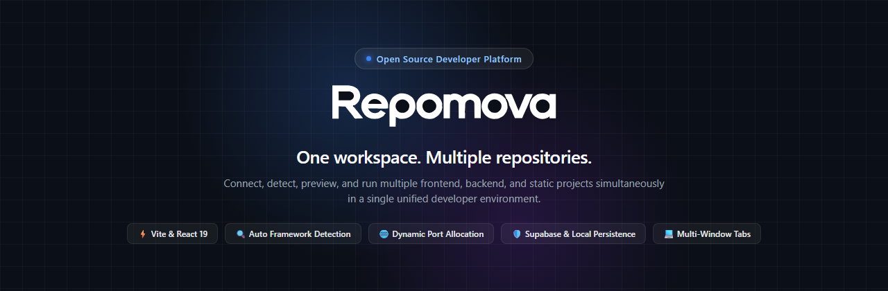
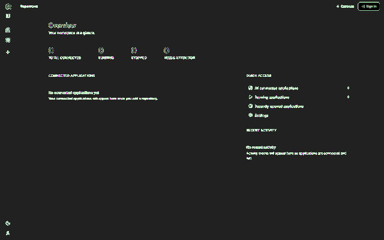
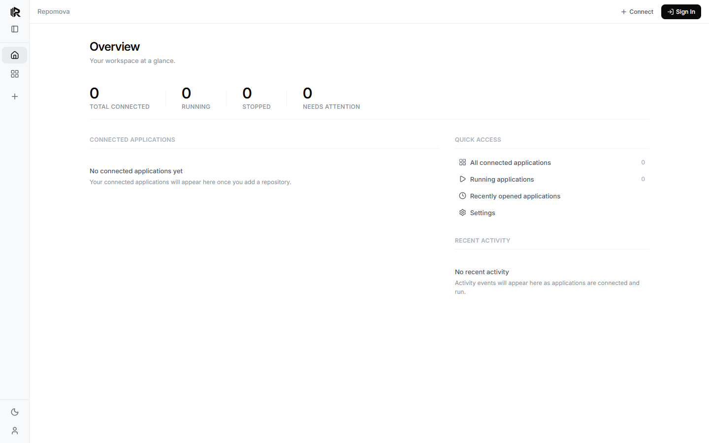
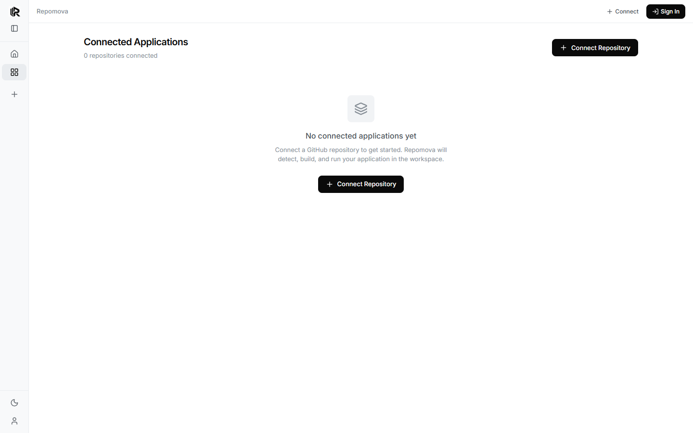

<div align="center">



# Repomova

**One workspace. Multiple repositories.**

[](LICENSE)
[](https://github.com/Elumugam/Repomova/actions)
[](https://react.dev/)
[](https://www.typescriptlang.org/)
[](https://vite.dev/)
[](CONTRIBUTING.md)

</div>

---

## Overview

Modern software development often requires working across multiple independent repositories simultaneously—such as a React frontend, a backend REST API, static documentation, and microservices. Juggling distinct terminal windows, conflicting local port assignments, scattered environment variables, and separate browser tabs is fragmented and error-prone.

**Repomova** unifies your development environment into a single, cohesive developer workspace. Connect your GitHub repositories, let Repomova automatically detect framework configurations, isolate runtime ports, configure environment variables, and manage multi-application execution inside an integrated, multi-window interface.

---

## Demonstration



---

## Key Features

Repomova provides verified, production-grade workspace capabilities:

- **Unified Multi-Repository Workspace**: Connect multiple repositories by GitHub URL or short identifier (`owner/repo`) and manage them from a single dashboard.
- **Multi-Window Tabbed Interface**: Open multiple connected applications simultaneously in independent tabs. Clone views, switch between active applications, or close tabs without terminating background services.
- **Automatic Framework & Runtime Detection**: Automatically analyzes repositories to identify project frameworks and runtimes—including React, Vite, Next.js, Vue, Angular, Svelte, Static Sites, Node.js, Python, Backend APIs, CLI tools, and Libraries.
- **Specialized Execution Modes**:
  - **Web Applications**: Real-time iframe previews with live port binding and asset resolution.
  - **Backend Services**: Interactive API Explorer with HTTP method selector, path builder, and instant `cURL` command generators.
  - **CLI Tools & Libraries**: Specialized project overviews, entry point inspection, and command references.
- **Dynamic Port Management & Health Checks**: Isolates local ports, detects conflicts before launching, and monitors application health before displaying live previews.
- **Guided Configuration Wizard**: Automatically extracts required environment variables from project `.env.example` templates, masks sensitive secrets, and validates configurations before launching.
- **Customization & Bookmarks**: Rename applications with friendly display names, assign custom thumbnails, and bookmark frequently used repositories.
- **Flexible Persistence**:
  - **Cloud Synchronization**: Full Supabase PostgreSQL persistence with Row-Level Security (RLS) for multi-device sync.
  - **Zero-Config Offline Mode**: Automatically falls back to local JSON database storage (`.repomova/auth_db.json`) when Supabase is not configured.
- **Authentication**: Built-in cryptographic user authentication (PBKDF2 with unique salts and timing-safe verification) with dedicated Sign In and Sign Up views.
- **Theme Support**: Clean, responsive modern UI with Light and Dark appearance modes and collapsible sidebar navigation.

---

## Application Screenshots

### Overview Dashboard
The central dashboard provides workspace metrics, recent activity tracking, running application counts, and quick access navigation.



### Connected Applications & Workspace
View connected repositories in a responsive grid, customize display names, configure environments, and launch applications.



---

## Technology Stack

### Frontend
- **Framework**: [React 19](https://react.dev/) (`19.2.8`)
- **Language**: [TypeScript](https://www.typescriptlang.org/) (`~6.0.2`)
- **Build Tool**: [Vite 8](https://vite.dev/) (`8.3.0`)
- **State Management**: [Zustand](https://zustand-demo.pmnd.rs/) (`5.0.15`)
- **Data Fetching**: [TanStack Query v5](https://tanstack.com/query) (`5.104.2`)
- **Icons**: [Lucide React](https://lucide.dev/) (`1.55.0`)
- **Styling**: Vanilla CSS with comprehensive CSS custom properties and responsive utility classes (`src/index.css`)

### Backend & Serverless API
- **Serverless Endpoints**: Vercel Serverless Functions (`api/auth/*`, `api/apps/*`, `api/ports/*`)
- **Runtime Gateway**: Local Node.js child-process executor and framework detector (`src/server/runtimeGateway.ts`, `api/apps/detect.ts`)
- **Database & Auth**: [Supabase](https://supabase.com/) PostgreSQL with Row-Level Security (`supabase/schema.sql`) and local file-based database fallback

### Tooling & Quality Assurance
- **Linter**: [Oxlint](https://oxc.rs/docs/guide/usage/linter) (`1.81.0`)
- **Test Runner**: [Vitest](https://vitest.dev/) (`5.0.3`) with [Testing Library](https://testing-library.com/) and `jsdom`

---

## Prerequisites

Before setting up Repomova locally, ensure you have the following installed:

- **Node.js**: `v20.x` or `v22.x` (LTS recommended; tested with Node 22)
- **npm**: `v10.x` or later (bundled with Node.js)
- **Git**: Installed and available in your system `PATH`
- *(Optional)* **Supabase Account**: Required only if you wish to enable cloud persistence and remote user authentication.

---

## Getting Started

### 1. Clone the Repository

```bash
git clone https://github.com/Elumugam/Repomova.git
cd Repomova
```

### 2. Install Dependencies

Install all project dependencies:

```bash
npm install
```

### 3. Configure Environment Variables

Create a local `.env` file by copying the example configuration:

```bash
# On Linux / macOS:
cp .env.example .env

# On Windows PowerShell:
Copy-Item .env.example .env
```

Open `.env` in your editor. If you do not have a Supabase project yet, you can leave the default placeholder values; Repomova will automatically start in **local demo mode** with local filesystem storage.

---

## Environment Variable Reference

See [.env.example](.env.example) for the full annotated configuration file.

| Variable | Required | Description |
| :--- | :---: | :--- |
| `VITE_SUPABASE_URL` | Optional | Your Supabase Project URL (`https://<project-id>.supabase.co`). Enables remote cloud persistence. |
| `VITE_SUPABASE_ANON_KEY` | Optional | Your Supabase public anonymous API key (safe for browser client-side use). |
| `SUPABASE_SECRET_KEY` | Optional | Supabase service-role key for administrative backend operations (serverless only). |
| `GITHUB_CLIENT_ID` | Optional | GitHub OAuth Application Client ID for repository authorization. |
| `GITHUB_CLIENT_SECRET` | Optional | GitHub OAuth Application Client Secret for serverless token exchange. |
| `RUNTIME_BASE_URL` | Optional | Custom base URL for external runtime execution microservice (defaults to local runtime). |
| `PREVIEW_GATEWAY_URL` | Optional | Custom base URL for preview proxy gateway. |

---

## Database and Backend Setup (Supabase)

To enable cloud persistence across devices:

1. Create a new project in the [Supabase Dashboard](https://database.new).
2. Navigate to **SQL Editor** in your Supabase project.
3. Open [`supabase/schema.sql`](supabase/schema.sql) from this repository, copy its contents, and run it in the SQL Editor. This initializes:
   - `public.profiles`: User profile data linked to Supabase authentication.
   - `public.connected_apps`: Connected repositories, runtime configurations, ports, and statuses.
   - `public.workspace_tabs`: Session tab state and ordering.
   - `public.app_logs`: Runtime event streams.
   - Row-Level Security (RLS) policies guaranteeing user isolation.
4. Go to **Project Settings** > **API**, copy your **Project URL** and **anon public key**, and add them to your `.env` file:
   ```env
   VITE_SUPABASE_URL=https://your-project-id.supabase.co
   VITE_SUPABASE_ANON_KEY=your-anon-key
   ```

---

## Development Scripts

The following commands are available via `npm run`:

| Script | Command | Purpose |
| :--- | :--- | :--- |
| `npm run dev` | `vite` | Starts the Vite development server with Hot Module Replacement at `http://localhost:5173` |
| `npm run lint` | `oxlint` | Runs Oxlint across all TypeScript and React files |
| `npm run test` | `vitest run` | Executes all unit and integration test suites |
| `npm run build` | `tsc -b && vite build` | Validates TypeScript types and compiles production bundle to `dist/` |
| `npm run preview` | `vite preview` | Previews the compiled production bundle locally |

---

## Usage Guide

1. **Start the Development Server**:
   ```bash
   npm run dev
   ```
2. **Access the Application**:
   Navigate to `http://localhost:5173` in your browser.
3. **Connect a Repository**:
   - Click the **+ Connect** button in the top navigation bar or the **Connect Repository** button in the dashboard.
   - Enter a public GitHub repository URL (e.g., `https://github.com/gabrielecirulli/2048`) or repository shorthand (`owner/name`).
   - Click **Connect Repository**. Repomova clones the project metadata and detects the project type automatically.
4. **Configure & Launch**:
   - If the project requires environment variables, the **Config Wizard** opens automatically. Provide the required values.
   - Click **Run Application**. Repomova allocates an isolated local port, installs dependencies, builds the project, and starts the service.
5. **Multi-Window Navigation**:
   - Click the **+** button in the workspace topbar to open an additional application window or blank workspace tab.
   - Switch between open tabs seamlessly without interrupting active background processes.
6. **Sign In / Account Management**:
   - Use the **Sign In** or **Sign Up** buttons in the topbar to register an account. Accounts function in both cloud mode (Supabase) and offline local mode.

---

## Project Structure Overview

```
repomova/
├── .github/                      # GitHub community health files & workflows
│   ├── ISSUE_TEMPLATE/           # Issue form templates (bug reports, features)
│   ├── PULL_REQUEST_TEMPLATE.md  # PR checklist and contribution guidelines
│   └── workflows/
│       └── ci.yml                # Automated CI pipeline (lint, build, test)
├── api/                          # Serverless API endpoints
│   ├── apps/                     # Framework detection, launch, preview, stop
│   ├── auth/                     # Session, signin, signup, signout, profile
│   └── ports/                    # Port availability verification
├── assets/                       # Visual assets for GitHub and documentation
│   ├── repomova-banner.png       # Branded high-resolution project banner
│   ├── dashboard.png             # Genuine Overview dashboard screenshot
│   ├── workspace.png             # Genuine Connected Apps screenshot
│   └── demo.gif                  # Animated workflow demonstration
├── public/                       # Static web assets, logos, and manifests
├── src/                          # Frontend application source code
│   ├── components/               # React components (Dashboard, Workspace, Modals)
│   │   ├── AppPreview.tsx        # Multi-runtime preview & API explorer
│   │   ├── ConfigModal.tsx       # Environment and config wizard
│   │   ├── ConnectModal.tsx      # Repository connection modal
│   │   ├── ConnectedAppsView.tsx # Connected apps grid and controls
│   │   ├── Sidebar.tsx           # Collapsible navigation sidebar
│   │   ├── Topbar.tsx            # Global navigation, tabs, and auth menu
│   │   └── WelcomeScreen.tsx     # Overview dashboard with metrics
│   ├── lib/                      # Utilities, Supabase client, and auth helpers
│   ├── server/                   # Runtime gateway and local process manager
│   ├── test/                     # Vitest test suites
│   ├── App.tsx                   # Main layout and view routing
│   ├── store.ts                  # Zustand workspace state management
│   ├── types.ts                  # TypeScript domain models and enums
│   └── index.css                 # Core CSS design system and variables
├── supabase/
│   └── schema.sql                # PostgreSQL database schema and RLS policies
├── .env.example                  # Documented environment variable template
├── .gitignore                    # Git exclusion rules
├── CONTRIBUTING.md               # Contributor guide and workflow
├── CODE_OF_CONDUCT.md            # Contributor Covenant v2.1
├── LICENSE                       # MIT License
├── SECURITY.md                   # Security vulnerability reporting policy
├── package.json                  # Dependencies and scripts
└── vite.config.ts                # Vite build configuration
```

---

## Contributing

We welcome contributions! Please review our [Contributing Guide](CONTRIBUTING.md) and [Code of Conduct](CODE_OF_CONDUCT.md) before submitting pull requests.

To contribute:
1. Fork the repository on GitHub.
2. Create a topic branch: `git checkout -b feat/my-new-feature`.
3. Verify your changes pass `npm run lint`, `npm run build`, and `npm run test`.
4. Open a pull request against the `main` branch.

---

## Security

Please report potential security vulnerabilities privately and responsibly. See our [Security Policy](SECURITY.md) for reporting channels and guidelines.

---

## License

This project is licensed under the **MIT License**. See the [LICENSE](LICENSE) file for details.

> *Note: Open-source licensing grants permission to use, study, modify, and distribute the software under the terms of the MIT license. It is legally distinct from trademark registration, corporate registration, or commercial endorsements.*

---

## Community & Links

- **Repository**: [https://github.com/Elumugam/Repomova](https://github.com/Elumugam/Repomova)
- **Issues**: [https://github.com/Elumugam/Repomova/issues](https://github.com/Elumugam/Repomova/issues)
- **Pull Requests**: [https://github.com/Elumugam/Repomova/pulls](https://github.com/Elumugam/Repomova/pulls)
- **Security Advisories**: [https://github.com/Elumugam/Repomova/security/advisories](https://github.com/Elumugam/Repomova/security/advisories)
